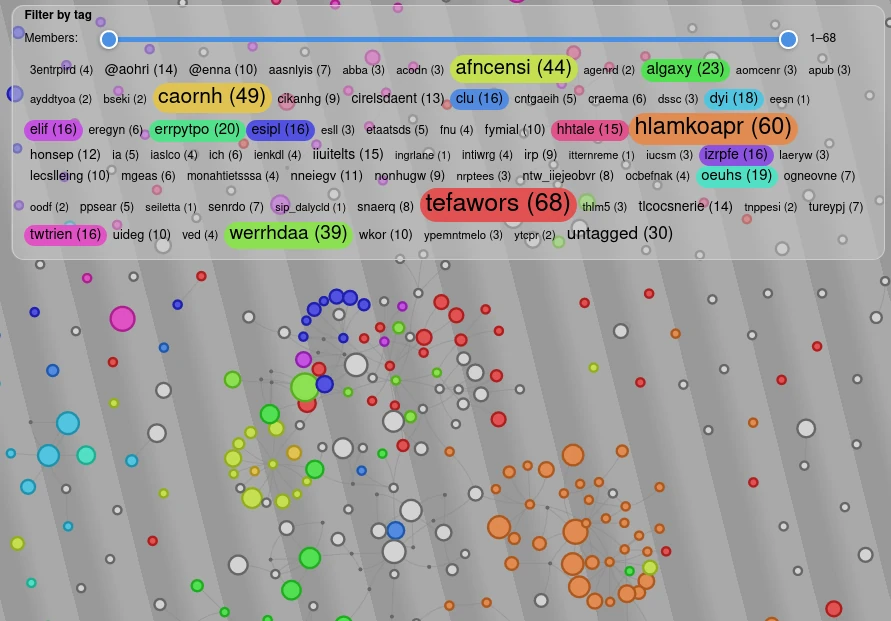

# org-roam-viz.el

A dynamic visualisation of your
[org-roam](https://github.com/org-roam/org-roam) database, drawing
inspiration from the `org-roam-graph` graphviz rendering, but built interactively for webpages.

 

### Web Summary

A single node is a node in the org-roam database, and an edge is the
link / webpage / file that joins them together. Nodes are coloured by
the primary tag they belong to (primary == most members in the same
tag), with visual filtering possible:
- Filter by tag names
- Filter tags by number of members

Zoomed in, the names of each node come into view and the nature of the edges reveal themselves too.

  

The size of each node is proportional to the size of the links within
it. If a link exists solely within a single node, then it is hidden by
default, but can be expanded by clicking on the node.

  

### Elisp Summary

Run `org-roam-viz-start`, and follow the messages.

##### Functions

* `org-roam-viz-init` needs to be run exactly once, builds the npm
  modules and the main HTML.
* `org-roam-viz-regenerate` exports the nodes/edges from org-roam
  database to JSON which is read by the HTML upon every refresh.
* `org-roam-viz-start` begins serving the visualisation. You can make
  edits to your org-roam and regenerate the graph whilst the
  visualisation is live and see the updates with a screen refresh.
  Default port is 3000.
* `org-roam-viz-stop` stops serving the visualisation.

##### Install

```elisp
(use-package org-roam-viz
  :straight (org-roam-viz
             :type git :host github :repo "mtekman/org-roam-viz"))
```

You can customize the bindings, and the serving port in the install decleration:

```elisp
(use-package org-roam-viz
  :straight (org-roam-viz
             :type git :host github :repo "mtekman/org-roam-viz")
  :bind (("C-c n g" . org-roam-viz-regenerate)
         ("C-c n z" . org-roam-viz-start)
         ("C-c n x" . org-roam-viz-stop))
  :custom (org-roam-viz-port 8914))
```
By default the package uses the `org-roam-db-location` to find the sqlite3 database, but
you can override this by changing the `org-roam-viz-db-file` setting.

